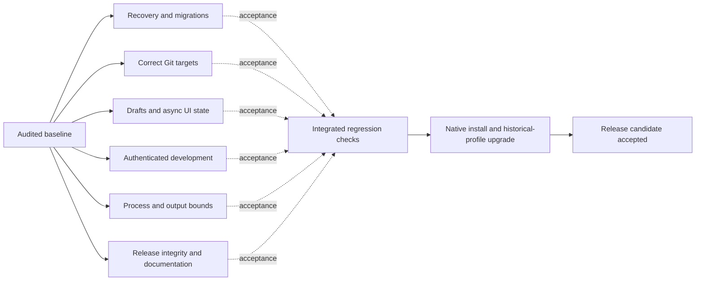

# Release readiness execution

Baseline: `d75f7ea`, 2026-10-15. The user authorized implementing the complete audit plan. The existing `.github/dependabot.yml` edit is unrelated and preserved. The initial implementation did not authorize publication. The user subsequently authorized committing, pushing and publishing 0.1.2; release progress is recorded separately.

Solid edges are implementation prerequisites; dashed edges are acceptance prerequisites. Independent fixes can proceed concurrently. Native acceptance requires the integrated candidate and actual supported machines/signing access; fixtures alone cannot close it.

| Node | Owner / exclusive files | Acceptance | State |
| --- | --- | --- | --- |
| DATA | Persistence lane: `state.rs`, `homes.rs` | Missing/corrupt primary recovery, retained migration backup, newer-schema refusal, customized instructions preserved, repeat migration safe | Implemented |
| GIT | Integrator: `git_ops.rs`, server Git wiring | Root/subfolder/worktree paths, discard/commit scope and bounded diffs tested | Implemented |
| UI | Frontend lane: components, draft/types helpers, browser tests | Draft navigation/restart/retry, inherited effort, skill launch, stale diff/avatar/save results | Implemented |
| AUTH | Integrator: `server.rs`, bridge, development bootstrap | Forged origins rejected; authenticated native/browser connection succeeds | Implemented |
| RUN | Integrator: `drivers.rs`, runtime wiring | Cancellation/completion cleanup and aggregate output limits with synthetic CLIs | Implemented |
| RELEASE | Release lane: release scripts, CI, public documentation | Exact source/CI binding, dependencies, license/history review, supported-platform and recovery procedures | Implemented |
| CHECK | Integrator | Typecheck/build, Rust fmt/test/Clippy, browser regressions, script tests and dependency checks on integrated source | Passed |
| NATIVE | Integrator / supported Mac environments | Fresh native install plus signed current-to-next update preserves historical profiles on Intel/ARM and oldest/current macOS | Partially verified; historical signed installation, physical Intel and macOS 11 remain open |

Three implementation lanes use explicitly disjoint files in the shared checkout. The integrator owns cross-lane contracts, package configuration, final checks and this document. Cargo builds serialize through Cargo's lock; browser lanes use separate ports and temporary report directories. No lane commits or publishes. Shared-interface changes go through the integrator.

The critical path is data safety, integrated checks, then real native upgrade acceptance. Numeric estimates are omitted until platform and signing availability is known. Regression results establish only their exercised behavior; unresolved gates remain open.

## Evidence and remaining work

The audit baseline passed 138 Rust tests and 50 browser tests but reproduced bugs outside those tests. The implementation now passes 154 Rust tests, formatting, Clippy with warnings denied, 23 Python safeguard tests, and 69 tests in each of Chromium and WebKit. Final browser and native packaging evidence is recorded in [local verification](local-verification.md).

The release path collects and verifies notices for 307 dependency records, with pinned provenance and explicit upstream omissions. Version 0.1.2 has a locally signed and notarized universal qualification archive. Identity, both architecture slices, hardened runtime, notarization ticket and Gatekeeper were checked in the bundle and extracted archive. The signed Apple Silicon app passes isolated HTTP/PTY/restart/migration smoke checks. Native UI setup, draft persistence across restart, a successful update check and refusal during an active task were also exercised.

This is an uncommitted worktree based on `d75f7ea`, not a public release tied to successful remote CI. Actual signed previous-to-next installation, physical Intel, the declared minimum macOS 11, and live provider compatibility remain open. Rosetta execution was attempted and unavailable on this host. No public release, tag, feed update or push occurred. These gates must remain explicit; local fixtures and notarization do not close them.
